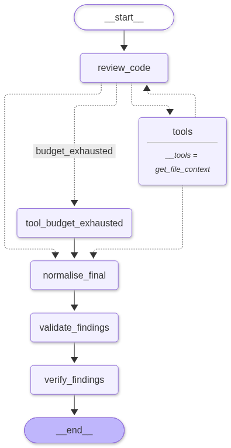

# AI Pull Request Investigator

AI Pull Request Investigator is a Python command-line tool that reviews a
GitHub pull request for actionable defects introduced by its changes. It uses
GitHub's API to load the pull request, a Qwen code-review model hosted through
Hugging Face Inference Providers to analyze it, and LangGraph to coordinate
model and tool calls.

## Features

- Accepts a GitHub pull request URL and loads its metadata and changed files.
- Builds review context from the PR description and unified diffs.
- Runs a correctness-focused review with structured findings:
  severity, category, file, line, explanation, evidence, and suggested fix.
- Lets the model request additional source context from the PR's head revision.
  Each request is limited to 150 lines, and the graph allows at most five tool
  calls per review.
- Validates the final JSON response with Pydantic.
- Checks whether each finding points to a changed file and a line present in
  that file's patch, identifying added lines versus context lines.
- Prints the validated findings as JSON in the terminal.
- Integrates a Langfuse callback for graph tracing when configured.

Location verification confirms that a finding points into the changed diff; it
does not independently prove that the finding is a real defect.

## Review workflow

The graph starts with the model review. If the model requests source context,
LangGraph runs the GitHub file-context tool and returns its result to the
reviewer. When the tool-call budget is exhausted, the reviewer is asked to
finalize using the evidence already gathered. The final response is validated
and its finding locations are checked before the CLI prints the result.



## Requirements and setup

- Python 3.11 or newer
- A Hugging Face access token with access to the configured inference provider
- Optional: a GitHub token for authenticated API requests (for example, to
  access private repositories or increase API rate limits)

Create and activate a virtual environment, then install the project
dependencies:

```powershell
python -m venv .venv
.\.venv\Scripts\Activate.ps1
python -m pip install -r requirements.txt
```

Set credentials in your shell or a local, untracked `.env` file:

```text
HF_TOKEN=your_hugging_face_token
GITHUB_TOKEN=your_github_token
```

`HF_TOKEN` is required. `GITHUB_TOKEN` is optional for public pull requests.
Never commit credentials.

## Run a review

Pass the PR URL directly:

```powershell
python -m app.main --pr-url https://github.com/owner/repository/pull/123
```

Or omit `--pr-url` to be prompted for it:

```powershell
python -m app.main
```

The command prints the validated `ReviewResult` as formatted JSON. A successful
review with no actionable findings returns an empty `findings` array.

## Chunk files at a pull request revision

Supply repository-relative text file paths from the revision you want to ingest.
Each request uses the PR's head SHA, and the returned batch carries its repository
owner, name, and SHA.

```python
from app.rag.ingestion import chunk_pr_files
from app.services.github_client import consolidate_pr_data
from app.services.pr_normalizer import normalize_pr_data

pr_url = "https://github.com/owner/repository/pull/123"
pr_context = normalize_pr_data(consolidate_pr_data(pr_url))
paths = ["src/service.py", "web/View.tsx", "config.yaml"]
batch = chunk_pr_files(pr_url, pr_context, paths)

for chunk in batch.chunks:
    print(
        chunk["filename"], chunk["language"], chunk["symbol"],
        chunk["start_line"], chunk["end_line"], chunk["parse_status"],
    )
```

The default limits are 100 lines and 8,000 characters per chunk, with up to 10
lines of overlap within a symbol or a class context region. An oversized line
can span multiple chunks with the same line number. Parse status applies to the
whole file. Unsupported extensions and parser failures use bounded text chunks.

The language pack may download grammars on first use. With a version that
downloads grammars on demand, prime its cache before running the chunking tests
offline:

```powershell
python -c "from tree_sitter_language_pack import prefetch; prefetch(['python', 'javascript', 'typescript', 'tsx', 'java'])"
python -m pytest -q tests/test_chunker.py tests/test_rag_ingestion.py
```

## Project structure

- `app/main.py` — CLI argument handling and review entry point.
- `app/graph.py` — LangGraph workflow, tool-call routing, and call budget.
- `app/agent.py` — model prompt, Hugging Face inference request, and response
  conversion.
- `app/nodes/` — review, finalization, validation, budget handling, and location
  verification nodes.
- `app/services/github_client.py` — GitHub API requests, source-line fetching,
  and unified-diff location checks.
- `app/services/pr_normalizer.py` — converts GitHub API data to the internal PR
  context and review prompt.
- `app/rag/` — language-aware code chunking with bounded text fallback.
- `app/schemas.py` — Pydantic finding and review-result schemas.
- `app/state.py` — graph state types.
- `app/tools/fetch_file_tool.py` — bounded source-context tool exposed to the
  model.
- `tests/` — project tests.

